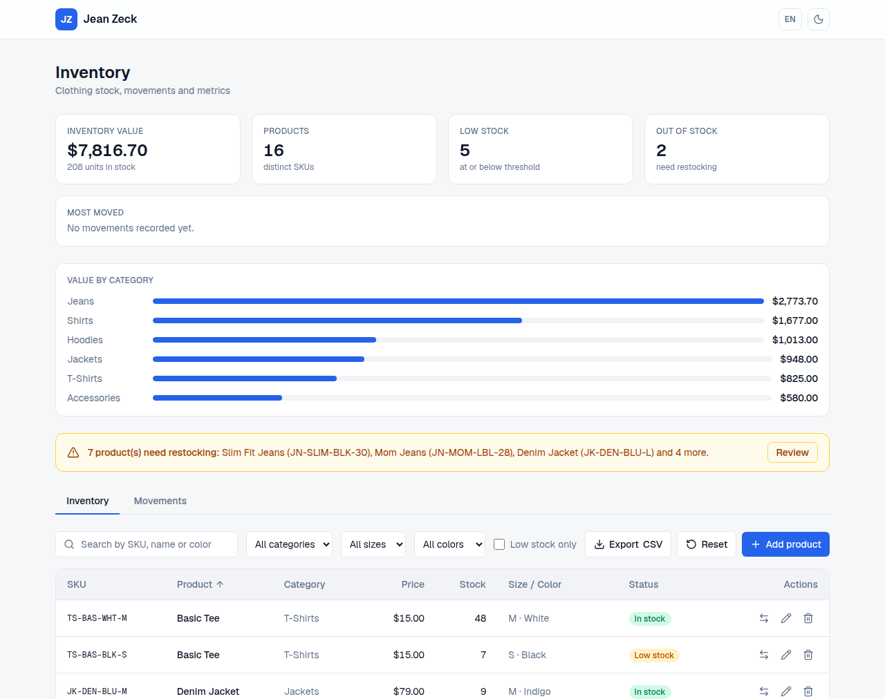
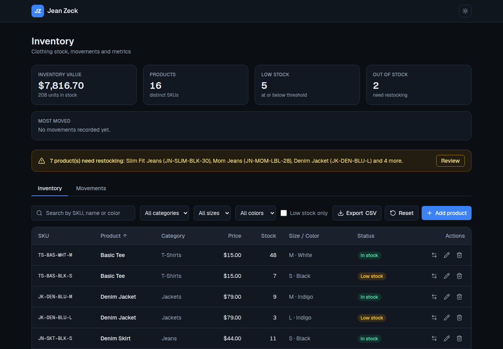
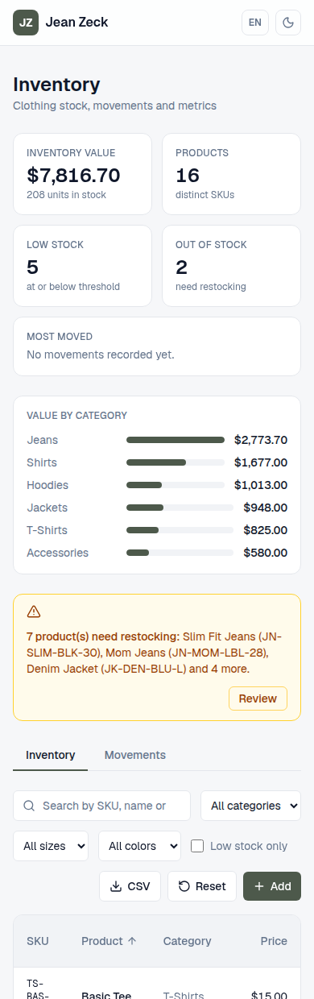

# Jean Zeck Inventory

A clothing inventory dashboard for a small retailer. Track products by SKU, category, size, color, price and stock, record stock movements, and watch live metrics. It runs entirely in the browser with seed data and localStorage, so there is no backend to set up.

**Live demo:** [sagudelo01.github.io/inventario_jean_zeck](https://sagudelo01.github.io/inventario_jean_zeck/)



## Features

- Product catalog with SKU, category, size, color, price, stock and a derived status (in stock, low stock, out of stock)
- Create, edit and delete products with inline form validation and clear error messages
- Stock movements (in and out) that adjust stock and build a dated history
- Search by SKU, name or color, plus filters by category, size, color and low stock
- Sortable columns and pagination
- Low-stock alerts with a one-click review filter
- Dashboard metrics: inventory value, product count, low and out-of-stock counts, and most-moved products
- CSV export of the current view
- Light and dark themes, responsive layout, and keyboard-accessible dialogs and tabs

## Screenshots

Dark theme and mobile layout:





## Stack

- Next.js (App Router) and React, with TypeScript
- Tailwind CSS v4
- lucide-react icons
- Client-side state persisted in localStorage (no backend)

## Running locally

```bash
git clone https://github.com/Sagudelo01/inventario_jean_zeck.git
cd inventario_jean_zeck
npm install
npm run dev
```

Open http://localhost:3000. Create a production build with `npm run build`.

## Data

The app ships with a seed catalog of 16 products. Changes to products and movements are saved in the browser's localStorage, so they persist across reloads on the same device. Use the Reset button to restore the original catalog and clear the movement history.
